 

<h1 data-importer="text" align="center">Hi, I'm Ali! 👋</h1>

###

  

###

 

I'm passionate about turning data into meaningful insights and solving real-world problems through programming and data analysis.  Currently, I'm developing my skills in Python, SQL, and Machine Learning by building practical projects and working with real-world datasets.

###

 

<h2 data-importer="text" align="left">👨‍💻 About Me</h2>

###

 

📊 Interested in Data Analysis, Data Science, and Machine Learning. 🐍 Working with Python and its data analysis libraries. 🗄️ Learning and practicing SQL for data querying and analysis. 📈 Experienced with Exploratory Data Analysis (EDA) and data visualization through personal projects. 🚀 Continuously learning and building projects to improve my technical skills.

###

 

<h2 data-importer="text" align="left">🛠️ Languages & Tools</h2>

###

  
  
  
  
  
  
  
  
  
  
  
  
  
  
  

###

 

  
  
  
  

###

 

<picture data-importer="pacman">
  <source media="(prefers-color-scheme: dark)" srcset="https://raw.githubusercontent.com/mobo2r-ali/mobo2r-ali/pacman-output/pacman-contribution-graph-dark.svg?game=pacman">
  <source media="(prefers-color-scheme: light)" srcset="https://raw.githubusercontent.com/mobo2r-ali/mobo2r-ali/pacman-output/pacman-contribution-graph.svg?game=pacman">
  
</picture>

###

 

<h2 data-importer="text" align="left">📫 Connect With Me</h2>

###

 

  
  
  

###
